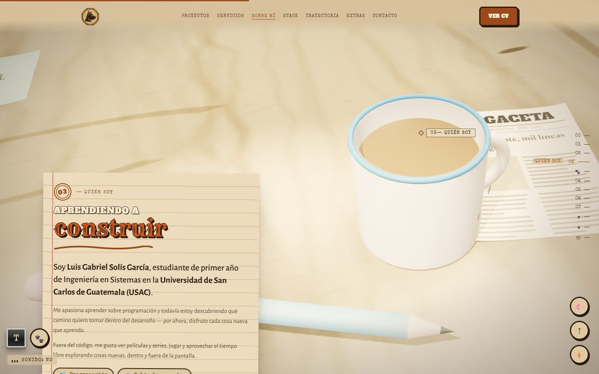
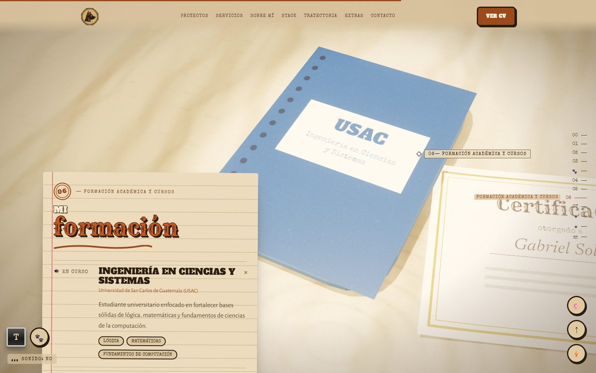
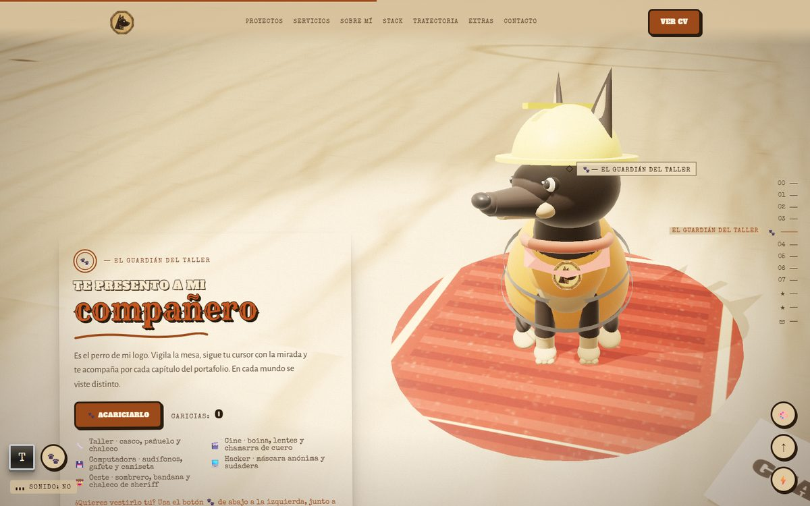

  

  
  
  

## 👋 Hola, soy Gabriel

Soy **Luis Gabriel Solís García**, estudiante de primer año de **Ingeniería en Ciencias y Sistemas en la USAC** (Guatemala). Construyo cosas que la gente usa de verdad: tiendas en línea que venden por WhatsApp, bots que agendan citas, apps de escritorio (un optimizador para Windows y un reproductor de música) y un radar de licitaciones públicas con IA. Fuera del código me gustan las películas, las series y los videojuegos.

- 🔭 **Ahora mismo:** mejorando [Triki Radar](https://radar.trikis.nl), un radar de licitaciones de Guatecompras con IA.
- 🌱 **Aprendiendo:** Rust, Next.js y la API de Claude.
- 🤝 **Busco:** proyectos para negocios pequeños (tiendas, catálogos, bots y paneles).
- 💬 **Hablemos:** en [trikis.nl](https://trikis.nl) o por [correo](mailto:gabrielsolis8002@icloud.com).

<table align="center"><tr>
<td width="33%" align="center"> <b>Quién soy</b></td>
<td width="33%" align="center"> <b>Mi formación · USAC</b></td>
<td width="33%" align="center"> <b>El guardián de mi logo</b></td>
</tr></table>

## 🛠 Lo que he construido

### 📡 [Triki Radar](https://github.com/Trikis67/Proyecto-con-ia-integrado) · licitaciones públicas con IA
Vigila Guatecompras dos veces al día, detecta cada cambio en las convocatorias, lee las bases en PDF con IA y le dice a cada empresa en cuáles le conviene ofertar y por qué. **[Verlo en vivo →](https://radar.trikis.nl)**

`Next.js 16` `TypeScript` `Supabase` `API de Claude` `GitHub Actions`

### 🎧 [Tk Play](https://github.com/Trikis67/Tk-Play) · reproductor de música de escritorio
Un reproductor con interfaz propia para **YouTube Music** y **Spotify**: toma los colores de cada carátula, muestra la **letra sincronizada** estilo karaoke, tiene ecualizador de 10 bandas y una tienda con **más de 100 temas, mods, mascotas y extensiones**. Se conecta con Discord y las teclas multimedia. **[Descargar →](https://github.com/Trikis67/Tk-Play/releases/latest)**

`Electron` `TypeScript` `Spotify SDK` `YouTube Music` `Web Audio`

### ⚡ [Optimizador para Windows · por Trikis](https://github.com/Trikis67/Optimizador) · app de escritorio · v0.3
Vigila CPU, memoria, GPU, disco y red en tiempo real, revisa la **salud del sistema** (discos, batería, pantallazos azules), limpia **drivers viejos** que pueden ocupar decenas de GB y optimiza para gaming o PCs de pocos recursos. Todo se puede deshacer y queda en un **historial**. Trae su propio instalador en español. **[Descargar v0.3 →](https://github.com/Trikis67/Optimizador/releases/latest)**

`Rust` `Tauri 2` `JavaScript` `NSIS`

### 📅 [Agenda de citas por WhatsApp](https://github.com/Trikis67/Agenda-de-citas-por-whatsapp) · bot para negocios
El cliente escribe «hola», elige servicio, día y hora, y la cita queda en el Google Calendar del encargado. Avisa al encargado y manda un recordatorio antes de la cita.

`Node.js` `WhatsApp Cloud API` `Google Calendar API`

### 🛍️ [El Rack de las Playeras](https://elrackdelasplayerasgt.lat) · tienda en línea con panel
Catálogo de playeras con filtros por marca y talla, carrito que arma el pedido por WhatsApp y un [panel de administración](https://github.com/Trikis67/catalogo) para subir productos con varias fotos y tallas.

`JavaScript` `Supabase` `GitHub Pages`

### 🛠 [Este portafolio · Taller 3D](https://github.com/Trikis67/portafolio)
Un taller en 3D con Three.js donde el scroll guía la cámara por cada sección. Tiene cinco mundos (taller, cine, computadora 2000, hacker y oeste), cada uno con su intro, sus sonidos y su ropa para el perro del logo. **[Visitarlo →](https://trikis.nl)**

`Three.js` `JavaScript` `Web Audio`

## 🧰 Stack

  
  
  
  
  
  
  
   
  
  
  
  
  
  
  
  
  

Hecho en Guatemala 🇬🇹 · <a href="https://trikis.nl">trikis.nl</a>

